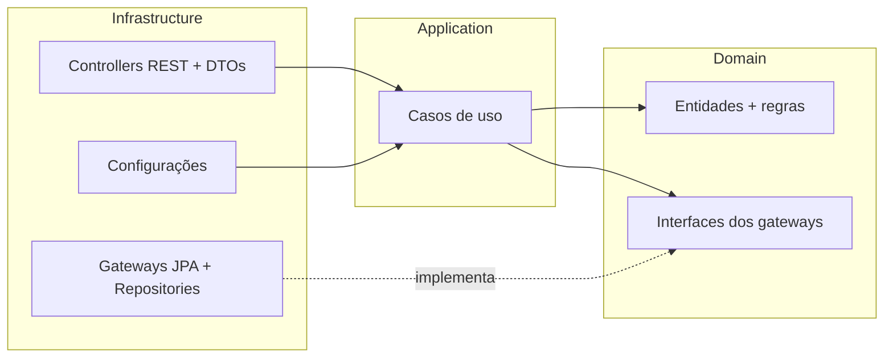
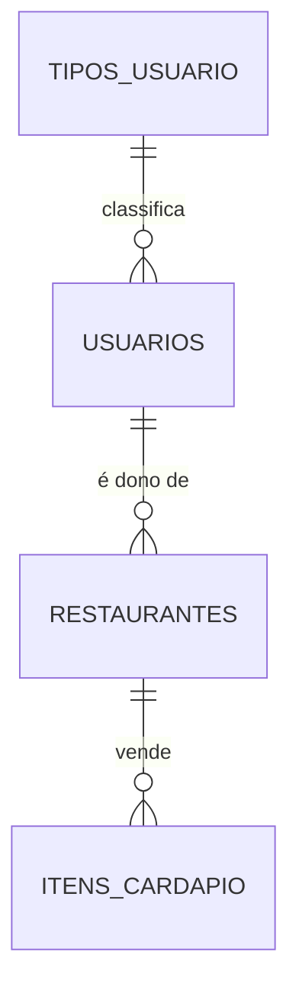

# Tech Challenge – Fase 2 · Sistema de Gestão de Restaurantes 🍝

Projeto da Fase 2 da pós-graduação **Arquitetura e Desenvolvimento Java (FIAP Pós Tech)**.

Nesta fase o sistema ganhou:

- **Tipos de usuário** ("Dono de Restaurante", "Cliente" e outros que forem cadastrados) e a associação de cada usuário a um tipo;
- **Cadastro de restaurantes**, sempre com um dono (que precisa ser do tipo "Dono de Restaurante");
- **Cadastro dos itens do cardápio** de cada restaurante.

---

## 📋 Sumário

1. [Tecnologias](#-tecnologias)
2. [Arquitetura (Clean Architecture)](#-arquitetura-clean-architecture)
3. [Regras de negócio](#-regras-de-negócio)
4. [Endpoints da API](#-endpoints-da-api)
5. [Como executar](#-como-executar)
6. [Testes e cobertura](#-testes-e-cobertura)
7. [Collection do Postman](#-collection-do-postman)
8. [Checklist dos entregáveis](#-checklist-dos-entregáveis)

---

## 🛠 Tecnologias

| Tecnologia | Para que usei |
|---|---|
| Java 21 | Linguagem |
| Spring Boot 3.5 | Web (API REST), Data JPA e Validation |
| PostgreSQL 16 | Banco de dados da aplicação |
| H2 | Banco em memória usado só nos testes de integração |
| Springdoc OpenAPI | Documentação Swagger |
| JUnit 5, Mockito, AssertJ, MockMvc | Testes unitários e de integração |
| JaCoCo | Relatório e verificação da cobertura de testes (mínimo 80%) |
| Docker e Docker Compose | Subir a aplicação e o banco juntos |

---

## 🏛 Arquitetura (Clean Architecture)

O código foi separado em três camadas. A regra mais importante é que **as dependências sempre apontam para dentro**: a infraestrutura conhece a aplicação e o domínio, mas o domínio não conhece ninguém (não tem nada de Spring nem de JPA nele).



```
src/main/java/br/com/fiap/techchallenge
├── domain                         ➜ coração do sistema, Java puro
│   ├── model                      ➜ TipoUsuario, Usuario, Restaurante, ItemCardapio (com validações)
│   ├── gateway                    ➜ interfaces de acesso a dados ("contratos")
│   └── exception                  ➜ ValidacaoException, NaoEncontradoException, RegraDeNegocioException
├── application                    ➜ casos de uso, Java puro
│   ├── dto                        ➜ dados de entrada dos casos de uso
│   └── usecase                    ➜ TipoUsuarioUseCase, UsuarioUseCase, RestauranteUseCase, ItemCardapioUseCase
└── infrastructure                 ➜ tudo que depende de framework
    ├── config                     ➜ criação dos beans dos casos de uso, Swagger e carga inicial
    ├── persistence
    │   ├── entity                 ➜ entidades JPA (tabelas)
    │   ├── repository             ➜ Spring Data JPA
    │   ├── mapper                 ➜ conversão entidade JPA ⇄ entidade de domínio
    │   └── gateway                ➜ implementação das interfaces do domínio
    └── web
        ├── controller             ➜ endpoints REST
        ├── dto                    ➜ requests e responses da API
        └── exception              ➜ tratamento global de erros
```

**Por que fiz assim?**

- As **entidades de domínio** se validam sozinhas no construtor (ex.: preço tem que ser maior que zero). Assim não existe objeto inválido circulando no sistema.
- Os **casos de uso** não têm `@Service`; eles são criados como `@Bean` na classe `UseCaseConfig`. Isso deixa a camada de aplicação independente do Spring e fácil de testar com Mockito.
- As **entidades JPA** ficam separadas das entidades de domínio, e os *mappers* fazem a conversão. Se um dia trocar o banco, só a infraestrutura muda.

### Associação usuário ⇄ tipo de usuário

Como usei banco **relacional (PostgreSQL)**, a associação é feita com uma **chave estrangeira**: a tabela `usuarios` tem a coluna `tipo_usuario_id` apontando para `tipos_usuario` (relacionamento muitos-para-um). O tipo é obrigatório no cadastro do usuário e pode ser trocado depois pelo endpoint `PATCH /usuarios/{id}/tipo`.



---

## 📏 Regras de negócio

1. Os tipos **"Dono de Restaurante"** e **"Cliente"** são criados automaticamente quando a aplicação sobe e não podem ser renomeados nem excluídos.
2. Não pode existir dois tipos de usuário com o mesmo nome, nem dois usuários com o mesmo email.
3. Um tipo de usuário só pode ser excluído se nenhum usuário estiver associado a ele.
4. O **dono do restaurante precisa ser um usuário do tipo "Dono de Restaurante"**.
5. Um usuário que é dono de algum restaurante não pode virar "Cliente" nem ser excluído.
6. Um restaurante só pode ser excluído se não tiver itens no cardápio.
7. O preço do item precisa ser maior que zero. A foto é opcional (guardamos só o caminho do arquivo).

### Status HTTP usados

| Status | Quando |
|---|---|
| 200 OK | Consulta ou atualização deu certo |
| 201 Created | Cadastro deu certo |
| 204 No Content | Exclusão deu certo |
| 400 Bad Request | Campo obrigatório faltando, valor inválido ou JSON mal formatado |
| 404 Not Found | Id não encontrado |
| 422 Unprocessable Entity | Quebra de regra de negócio (ex.: dono do restaurante é Cliente) |

Exemplo de resposta de erro:

```json
{
  "dataHora": "2026-10-18T19:30:00",
  "status": 400,
  "erro": "Bad Request",
  "mensagem": "Existem campos inválidos na requisição",
  "detalhes": ["nome: O nome é obrigatório"]
}
```

---

## 🔌 Endpoints da API

Com a aplicação rodando, a documentação interativa fica em **http://localhost:8080/swagger-ui.html**.

### Tipos de usuário – `/tipos-usuario`

| Método | Rota | Descrição |
|---|---|---|
| POST | `/tipos-usuario` | Cadastra um tipo |
| GET | `/tipos-usuario` | Lista todos os tipos |
| GET | `/tipos-usuario/{id}` | Busca um tipo pelo id |
| PUT | `/tipos-usuario/{id}` | Atualiza o nome do tipo |
| DELETE | `/tipos-usuario/{id}` | Exclui o tipo |

```json
{ "nome": "Funcionário" }
```

### Usuários – `/usuarios`

| Método | Rota | Descrição |
|---|---|---|
| POST | `/usuarios` | Cadastra um usuário já associado a um tipo |
| GET | `/usuarios` | Lista todos os usuários |
| GET | `/usuarios/{id}` | Busca um usuário |
| PUT | `/usuarios/{id}` | Atualiza os dados do usuário |
| PATCH | `/usuarios/{id}/tipo` | **Associa o usuário a outro tipo** |
| DELETE | `/usuarios/{id}` | Exclui o usuário |

```json
{
  "nome": "Maria Souza",
  "email": "maria@email.com",
  "login": "maria.souza",
  "tipoUsuarioId": 1
}
```

Associação com o tipo (`PATCH /usuarios/{id}/tipo`):

```json
{ "tipoUsuarioId": 1 }
```

### Restaurantes – `/restaurantes`

| Método | Rota | Descrição |
|---|---|---|
| POST | `/restaurantes` | Cadastra um restaurante |
| GET | `/restaurantes` | Lista todos |
| GET | `/restaurantes/{id}` | Busca um restaurante |
| PUT | `/restaurantes/{id}` | Atualiza o restaurante |
| DELETE | `/restaurantes/{id}` | Exclui o restaurante |

```json
{
  "nome": "Cantina da Nona",
  "endereco": "Rua das Flores, 123 - Centro",
  "tipoCozinha": "Italiana",
  "horarioFuncionamento": "Terça a Domingo, das 11h às 23h",
  "donoId": 1
}
```

### Itens do cardápio – `/itens-cardapio`

| Método | Rota | Descrição |
|---|---|---|
| POST | `/itens-cardapio` | Cadastra um item |
| GET | `/itens-cardapio` | Lista todos os itens |
| GET | `/itens-cardapio?restauranteId={id}` | Lista os itens de um restaurante |
| GET | `/itens-cardapio/{id}` | Busca um item |
| PUT | `/itens-cardapio/{id}` | Atualiza o item |
| DELETE | `/itens-cardapio/{id}` | Exclui o item |

```json
{
  "nome": "Lasanha à bolonhesa",
  "descricao": "Lasanha caseira com molho bolonhesa",
  "preco": 49.90,
  "disponivelApenasNoLocal": false,
  "caminhoFoto": "/imagens/pratos/lasanha.jpg",
  "restauranteId": 1
}
```

---

## ▶ Como executar

### Pré-requisitos

- **Docker** e **Docker Compose** (para a opção 1)
- **Java 21** e **Maven 3.9+** (para a opção 2 e para rodar os testes)
- **VS Code** com as extensões recomendadas (o VS Code sugere sozinho ao abrir a pasta: Extension Pack for Java, Spring Boot Extension Pack, Docker e REST Client)

### Opção 1 – Tudo pelo Docker Compose (mais fácil)

```bash
docker compose up --build
```

Isso sobe o PostgreSQL e a aplicação. Quando aparecer `Started TechChallengeApplication` no log:

- API: http://localhost:8080
- Swagger: http://localhost:8080/swagger-ui.html

Para parar: `docker compose down` (e `docker compose down -v` se quiser apagar os dados do banco também).

### Opção 2 – Banco no Docker e aplicação pelo VS Code

1. Suba só o banco: `docker compose up -d postgres`
   (ou no VS Code: `Ctrl+Shift+P` → **Tasks: Run Task** → *Subir só o banco*)
2. Abra a aba **Run and Debug** (`Ctrl+Shift+D`) e rode **"Rodar aplicação"**,
   ou pelo terminal: `mvn spring-boot:run`

A conexão com o banco pode ser mudada pelas variáveis de ambiente `DB_URL`, `DB_USERNAME` e `DB_PASSWORD`.

---

## ✅ Testes e cobertura

```bash
mvn clean verify
```

Esse comando roda **todos os testes** e o **JaCoCo verifica se a cobertura de linhas é de pelo menos 80%** (se ficar abaixo, o build falha). O relatório fica em:

```
target/site/jacoco/index.html
```

No VS Code também dá para rodar pelo **Testing** (ícone de tubo de ensaio) ou pela task *Rodar testes + cobertura*.

| Tipo | Onde fica | O que testa |
|---|---|---|
| Unitários do domínio | `src/test/.../domain/model` | Validações das entidades (campos obrigatórios, email, preço, dono do restaurante) |
| Unitários dos casos de uso | `src/test/.../application/usecase` | Regras de negócio, com os gateways "mockados" pelo Mockito |
| Integração | `src/test/.../integration` | Sobe a aplicação inteira com banco H2 e chama os endpoints com MockMvc (controller → caso de uso → gateway → banco) |

Os testes de integração usam `@Transactional`, então cada teste começa com o banco limpo (só com os tipos padrão).

---

## 📮 Collection do Postman

Arquivo: [`postman/tech-challenge-fase2.postman_collection.json`](postman/tech-challenge-fase2.postman_collection.json)

1. No Postman: **Import** → selecione o arquivo.
2. Com a aplicação rodando, clique com o botão direito na collection → **Run collection**.
3. As requisições guardam os ids criados em variáveis, então dá para rodar tudo em sequência. As pastas são:
   1. Tipos de Usuário · 2. Usuários · 3. Restaurantes · 4. Itens do Cardápio · 5. Cenários de erro · 6. Limpeza

Também deixei o arquivo [`requests.http`](requests.http) para testar direto no VS Code com a extensão **REST Client**.

---

## 📦 Checklist dos entregáveis

| # | Entregável | Onde está |
|---|---|---|
| 1 | Funcionalidades (tipo de usuário, restaurante, itens do cardápio) | Controllers em `infrastructure/web/controller` |
| 2 | Qualidade do código / boas práticas Spring Boot | Injeção por construtor, Bean Validation, `@RestControllerAdvice`, DTOs, Swagger |
| 3 | Documentação do projeto | Este README + Swagger |
| 4 | Collection para testes | `postman/` e `requests.http` |
| 5 | Docker Compose | `docker-compose.yml` + `Dockerfile` |
| 6 | Repositório aberto | Link: _colocar aqui o link do GitHub_ |
| 7 | Clean Architecture | Pacotes `domain`, `application` e `infrastructure` |
| 8 | Cobertura de testes ≥ 80% + testes de integração | `mvn clean verify` (JaCoCo) |
| 9 | Vídeo de ~5 minutos | Link: _colocar aqui o link do vídeo_ · roteiro em [`docs/roteiro-video.md`](docs/roteiro-video.md) |

---

👩‍💻 Desenvolvido por **_[seu nome]_** – FIAP Pós Tech, Arquitetura e Desenvolvimento Java.
